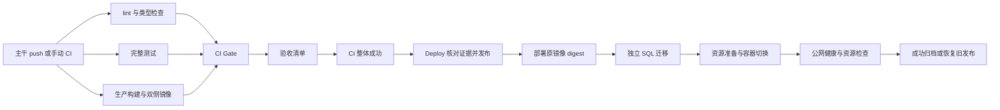

# 发布与回滚手册

## 日常发布

1. 功能与修复 PR 合入 `release/2.0`，release-please 根据 Conventional Commits 更新一个 release PR。普通 PR 用 merge commit，release PR 用 squash merge。
2. 主干每次 push 先运行完整 `CI`，包括全部测试与双侧镜像构建。`Release evidence` 只有在 `CI Gate` 和镜像任务成功后才能上传验收清单；清单绑定同一 SHA、当前 attempt 和镜像 digest。
3. `Deploy` 监听主干 CI 成功事件，核对真实运行、全部必需任务和当次清单。manifest 中的版本尚未发布时，在 `release-state` 锁内登记候选，创建 tag、GitHub Release 和 `release-manifest.json` 附件，然后部署原 digest。Deploy 不再重复运行测试或构建镜像。
4. 在 Actions 的 Deploy summary 查看实际部署版本、提交、双侧镜像和 schema。GitHub Release 表示候选已完成验收，**不表示生产部署成功**。

`release-please-config.json` 的 `exclude-paths` 是目录过滤，不支持单个文件或 glob。仅修改 `.github/`、`scripts/`、`docs/` 或 `web/e2e/` 的提交不单独触发应用版本；混合应用源码的提交仍参与版本计算。纯 CI、运维或文档 PR 使用 `chore`、`ci`、`test`、`docs` 等类型，包括同时修改 README 或发布配置的情况。不要靠手动关闭 release PR 或修改已有 tag 纠正提交分类。



候选登记、正式发布与 release PR 维护共用 `release-state` 锁；检查和构建不占锁。生产事务另用 `deploy-production` 锁，服务器保留文件锁。两个 Actions 并发组均使用 `queue: max`，最多保留 100 个等待任务；入队次序不代表提交先后。运行被取消或队列满时，候选仍可从 `release-candidate` 及 manifest 恢复，不能把 Actions 队列当作唯一记录。

同版本尚未发布时，后续完整 CI 成功的后代 SHA 可以推进候选，修复失败候选不需要升版本。晚完成的旧运行不能覆盖新候选；已发布版本的后续 CI 只做验证，不重新发布或部署。release-please 在当前版本公开发布且清单完整前暂停下一张 release PR，发布后主动触发维护。进入生产锁后仍检查祖先关系，已被线上双侧版本包含的旧发布不会覆盖生产。不要手工移动或删除候选分支。

lint、类型检查、构建和测试拆为独立任务并行执行。API 的构建、golangci-lint、数据库测试与镜像构建互不等待；仅数据库测试启动 PostgreSQL。Web 的 lint、类型检查、生产构建、站点单测和独立包验收并行，浏览器契约下载一次生产构建产物后运行。`Backend (Go)`、`Frontend (React)` 和 `CI Gate` 核对实际结果；发布另行要求完整 CI 的每个任务成功，skipped 不充当通过。

CI 包含 PostgreSQL 仓储与迁移集成测试、前端构建及 Playwright 契约测试，以及工作流、部署脚本和 Compose 校验。镜像用提交标签保存，实际部署只使用构建产出的 `ghcr.io/...@sha256:...`，不读取或改写 `latest`。

Omarchy 自托管 CI 的镜像更新须先通过 `Runner acceptance`：同一份 CI 强制双侧全量与镜像构建，禁止回退官方 runner。验收和工作流合入完成后才能开启 `SELF_HOSTED_RUNNER`，具体操作见 [Runner 运维指南](runner-setup.md#完整-ci-验收与启用)。生产部署仍固定使用 rua runner。

### PR 影响范围与耗时分片

PR 对照目标分支的 merge base 生成选测计划，不根据提交标题跳过检查。Go 使用 `go list` 的生产、测试和 integration 依赖图选择变更包及其反向依赖；Vitest 使用实际模块依赖图；浏览器契约使用显式影响映射。删除、重命名、共享配置、生成输入或无法证明影响范围的变更保守全量。选测计划保存理由与文件清单，Web summary 同时显示选择数量和理由；计划中的测试失败、漏跑或意外跳过都会阻断门禁。

仅介绍文档的 PR 不启动应用重任务。顶层 `api/README.md`、`web/README.md`、根 README 和根文档配图不作为应用输入；被站点导入的 Markdown、包内 README 和示例仍参与选测。主干 push、手动 CI 和 Runner acceptance 始终全量，不受文档排除影响。

站点单测最多 3 个分片，浏览器契约最多 2 个分片。按历史成功测试耗时的中位数降序分配，每次放入预计剩余工作最少的分片；无历史的文件仍会执行，使用保守默认值。PR 只读取主干缓存，只有完整主干验收成功的测试报告可更新耗时历史；失败、超时和重试样本不参与估算。

PR 的 Web 镜像任务只在 Docker 输入或依赖清单变化时运行；源码始终由独立的生产构建任务验证。主干 CI 构建并推送双侧 SHA 镜像，发布直接消费其 digest，不再构建第二份镜像。Runner acceptance 构建镜像但不发布。

工作流语法检查使用 [actionlint 并发队列补丁](https://github.com/rhysd/actionlint/pull/654)的固定提交 `644076a59742c2d1540ebd4686eab3c308f0e562`，源码归档在构建前校验 SHA-256。上游正式版 1.7.12 尚不识别 GitHub 已支持的 `queue`，本地使用该旧版会误报；检查器安装步骤见 `ci.yml`。未屏蔽语法错误，非法队列值及 `queue: max` 与取消运行的冲突仍会失败。

独立包仍保留自己的验收边界：站点单测不重复执行 `ui`、`react-tweet`、`kanban`、`theme` 的测试；`inkline`、`agent-status`、`mascot` 沿用站点配置。独立包的类型检查、浏览器行为和真实 tarball 消费继续执行，PR 仅选择受影响的包。

三个 required check 为 `Backend (Go)`、`Frontend (React)` 与 `CI Gate`。未选中的应用任务以 skipped 结束；被选中的任务必须 success。检测结果缺失、runner 选择失败、必要任务失败或取消都会使 `CI Gate` 失败，不能把前置失败造成的跳过当成无变更。

本地验证最终门禁的退出码与失败传播：

```bash
node --test web/scripts/ci-tests.test.mjs
python3 -m unittest discover -s scripts/tests -p 'test_ci_*.py' -v
python3 -m unittest discover -s scripts/tests -p 'test_web_results.py' -v
```

### 多个 PR 与补丁版本

默认不写 `Release-As`，由 release-please 对本批提交统一推导版本。用户明确要求锁定版本时，在发布批次确定后集中设置一次意图，避免多个并行分支各自把“下个 patch”写死。

PR 检查拒绝小于或等于目标分支 manifest 的版本意图；release-please 执行前再次检查最新主干整个未发布批次。若 release PR 先合并、旧 PR 后合并，过期 footer 会让发布流程明确失败，不能静默重用旧版本。修复时移除或更新尚未合并分支中的过期 footer；若已进入主干，需维护者处理该批次历史，普通追加一个新 footer 不会抵消旧 footer。

这不是合并队列。若分支规则允许使用旧的绿色检查，PR 仍可能合入，然后被发布前检查拦住。启用“合并前分支必须更新”可把失败提前到合并前。

## 生产事务与归档

公开入口由 `nginx-proxy` 提供 TLS，`/api/` 和 `/uploads/` 转发至 API，其余页面由 Web SSR 服务。带 hash 的静态资源由 nginx 的共享目录提供，其中包括流程图用的 Excalifont 与中文 Xiaolai SC 字体分片（约 16 MB、三百余个 woff2，只在图表需要对应字符时按需下载）。PostgreSQL、Redis、上传和备份使用独立卷。

文章页 `/blog/{slug}` 的匿名 GET（无查询参数、无会话及鉴权头）在 Web SSR 进程内缓存完整 HTML，按路径与外观/主题/装饰 cookie 区分：20 秒内命中，过期重渲染失败时旧版最多再兜底 120 秒。运行时文章更新最多等待 20 秒可见，后端故障时最多 140 秒；发布与回滚会重启 Web 进程并清空副本。

带未知 cookie（可能是会话）、`Authorization`、`Set-Cookie`、禁止缓存响应、非 200 或非 HTML 都不会共享。文章 HTML 对浏览器/代理返回 `Cache-Control: private, no-store`，静态资源仍由 nginx 保持一年 `immutable`。验收可连续运行 `curl -sS -D - -o /dev/null https://<域名>/blog/<slug>`，对照 `x-ssr-cache: miss` / `hit`；再带登录 cookie 请求，应没有该响应头。

音乐是可选后端模块。默认 Compose 自建空 `violet_music` 网络；同机接入 Kite 时由 `.env` 显式指定 `KITE_NETWORK_NAME=kite_network`、`KITE_NETWORK_EXTERNAL=true`，发布前确认该外部网络已存在。只有 API 加入 Kite 专网，服务令牌与 Cookie 加密密钥仅留在后端部署环境。前置配置及验收见 [Kite 音乐服务](manual-deploy.md#kite-音乐服务可选)。

首次接入要求现有 API/Web 容器与 Compose 配置齐全、数据库迁移记录 clean。脚本先捕获实际镜像 ID 和配置，保存为 `bootstrap-*` 归档，再部署候选。它不是空服务器安装器。后续版本以 `/root/docker/violet/.releases/` 为准：

| 文件 | 运维用途 |
|---|---|
| `current.json` | 已验证的实际镜像组合、提交与数据库版本 |
| `versions/<版本>/` | 成功发布的清单、Compose 与 nginx 配置快照 |
| `schema.json` 与 `migrations/` | 当前 schema 及旧镜像恢复所需的迁移文件束 |
| `pending.json` 与 `transactions/` | 未完成事务与恢复依据 |
| `paused.json` | 用户主动回滚后暂停正向部署，显式成功恢复才删除 |

旧 `.current-version-api/web` 只用于首次导入，不再写入。归档版本绑定唯一镜像组合，不允许把同一个版本改成另一组镜像。默认部署 `both`；手动单侧发布会保留另一侧镜像及来源提交，但依然归档整套组合。**不能先用同一版本部署 API，再用它补部署 Web**；补齐时使用新提交或新版本。来源不明或交叉的单侧版本会被拒绝，改用更新的双侧发布。

切换前先拉取固定 digest、执行独立 `/migrate up`、准备静态资源。静态文件逐个原子替换，保留旧 hash 文件，避免打开中的页面丢失旧资源。切换后校验实际容器镜像、公网 API 健康、文章分页响应、SSR HTML 和同源 JS/CSS。

公网验收使用独立直连，不继承镜像拉取配置的 `HTTP_PROXY` / `HTTPS_PROXY`，HTTPS 证书仍按默认信任链校验。脚本不修改进程代理环境，镜像拉取继续使用原有代理。排查验收连接错误时检查服务器到站点的直连路径，不能仅以镜像代理可用判断站点可达。

生产 API 启动只检查 schema，不执行 SQL 迁移或 GORM AutoMigrate。迁移成功后发生资源准备、切换或健康检查失败，会恢复上一份双侧镜像与配置，并重新验证；此次部署仍报告失败。数据库不自动降级。旧 API 恢复时只读挂载与当前 schema 对应的迁移文件束，避免旧启动器因缺少新迁移文件无法启动；**这不保证旧业务代码兼容破坏性 schema 变化**，迁移必须保留回滚窗口内的读写兼容性。

API 镜像内置固定 `cwebp 1.6.0`，构建阶段实际执行 PNG→WebP 探针；Go 服务仍以 `CGO_ENABLED=0` 构建，编码器为独立静态程序。启动与策略发布再次验证工具版本和编码能力，依赖缺失会明确失败，不以错误工具返回的“成功版本号”替代能力检查。

开发与生产 API 均以 UID/GID `65532` 运行。开发 Compose 的 `api-volume-init` 仅在启动前准备编译缓存和备份卷属主；API 不以 root 运行。首次升级时执行 `docker compose -f docker-compose.dev.yml up --build -d`，由该一次性服务处理旧 root 卷；不要手工对整个开发目录递归 `chmod`。


## 回滚与手动部署

回滚仅接受服务器已归档的完整发布，恢复双侧镜像和配置；不构建、不拉远程镜像、不执行迁移。所需镜像必须仍在服务器缓存。

```bash
gh workflow run deploy.yml --ref release/2.0 -f version=v2.0.1 -f skip_build=true -f component=both
```

将 `v2.0.1` 换成 `versions/` 下的实际归档名，也可指定首次捕获的 `bootstrap-*`。旧流程留下的 tag 不等于可回滚归档。不要为腾空间清理归档引用的镜像或迁移文件束。

主动回滚在服务器写入 `paused.json`，阻止排队的正向部署。恢复时选择已验证版本并显式传 `resume=true`；只有部署与健康检查成功才解除暂停，恢复失败或过期候选不会解除。

```bash
gh workflow run deploy.yml --ref release/2.0 -f version=v2.0.2 -f resume=true
```

普通重试已有版本只需 `version`，复用该 Release 的镜像清单：

```bash
gh workflow run deploy.yml --ref release/2.0 -f version=v2.0.2
```

不填 `version` 和 `revision` 时继续已冻结候选。未发布候选的源码需要修复时，先合入修复并等待该 SHA 的完整主干 CI 成功；自动发布会选择同版本的后代 SHA。需要人工选择时，核对新增提交与 CHANGELOG 后执行：

```bash
git fetch origin release/2.0
gh workflow run deploy.yml --ref release/2.0 \
  -f version=v2.0.2 -f revision="$(git rev-parse origin/release/2.0)"
```

这只选择已有完整主干 CI 证据的 SHA；没有对应成功运行、当次清单或镜像 digest 就立即拒绝，不在 Deploy 中隐式补跑。已有正式 tag 的源码和镜像不可改写。完整 Release 的重新部署及服务器归档回滚不依赖临时 CI artifact，也不重跑验收；旧 Release 缺少清单时仍须明确版本并提供其原 SHA 的可信完整 CI 证据。

若历史 Release 已启用不可变保护，GitHub 不允许补传清单附件，此迁移会明确失败，不会绕过保护或移动 tag。此类旧版本仍可使用服务器已有归档回滚；不能把它视为已具备新流程的清单复用能力。

Runner 不可用时通过 SSH 调用同一个事务入口，详见 [手动部署指南](manual-deploy.md)。不要用重打 `latest`、直接 `compose up` 或清空静态目录替代归档恢复。

## 失败处理

- **CI 失败**：先修复失败场景；未获得完整成功证据的 SHA 不进入部署。需要重跑 CI 时重跑整次运行，不以旧 attempt 的成功任务拼接新证据。已移除部署构建自动重试，Deploy 不再承担应用验收或镜像构建。
- **网络准备失败**：checkout 设置低速中止和步骤超时，发布源码保留完整提交历史但按需下载文件；GHCR 登录最多尝试三次，每次限时 60 秒，失败后不会进入部署事务。这些重试不包含迁移、容器切换或整个 deploy job。先按 [Runner 出网检查](runner-setup.md#部署出网) 验证代理和结果上传链路，再决定是否人工重跑。
- **清单上传失败**：GitHub 上传接口要求明确的 UTF-8 字节长度；`gh api --input -` 不会自动为标准输入设置 `Content-Length`，发布脚本须显式提供。协议错误不要求创建新版本，也不能重打 tag；保留已通过的 CI、镜像 digest 与运行证据，修复上传后恢复同一版本。清单尚未完整前不维护下一版 release PR。
- **部署已恢复旧版本**：查看失败日志与 summary，确认 `current.json` 的实际版本。若源码和镜像未变，修复环境后按原版本清单重试；需要修改已发布源码时才创建修正版。自动故障恢复不等于用户主动回滚，不写入 `paused.json`。
- **部署与恢复均失败**：错误摘要分别保留 `Deploy failed` 和 `restoration failed` 上下文；先区分首次失败与恢复失败的阶段，再检查 `pending.json`。摘要不输出子进程参数、标准输出或错误输出中的凭据；命令错误保留退出码或超时时间。
- **迁移失败或事务中断**：保留 `pending.json` 并阻止后续部署。先检查该记录的 phase、事务目录、当前容器镜像、`schema_migrations` 和公网状态。dirty 记录说明 SQL 可能部分执行；依据实际 schema 修复迁移，不能盲目 `force` 或删除 pending。
- **需要人工解除 pending**：先完成数据库一致性核对、恢复匹配的镜像与配置、验证公网，再将实际状态与 `current.json` 对齐并保留事故证据。只有确认不存在未完成写入时才能移除 pending；无法确认时保持阻断。

失败告警在托管 runner 上创建 Issue，按 run id 复用；同一 run 再次失败会重开已关闭告警。恢复成功后由维护者核对生产状态并关闭 Issue。告警不能替代运行结果与实际版本检查。

## GitHub 配置与上线边界

Go 检查与漏洞扫描从 `api/go.mod` 读取工具链版本；生产与开发镜像固定同一补丁版本。升级 Go 时同步更新 `go.mod` 和两份 API Dockerfile。

依赖漏洞（Go 的 `govulncheck` 与前端 `pnpm audit --prod`）只告警、不阻断 CI 与发版：发现项写入注解与任务摘要，升级走 dependabot 或人工；只有扫描工具自身执行失败才使 `Dependency Scan` 失败。因此 CI 通过不代表依赖零漏洞，风险需单独跟踪。

工作流文件之外还需维护分支规则、tag 规则、production 环境与 runner 权限。此次代码改造不修改这些仓库设置：

- `release/2.0` 必须要求 `Backend (Go)`、`Frontend (React)`、`CI Gate` 通过；更名 required check 时，含新名称的提交推送后立即更新 ruleset，并让其他开放 PR 同步基线，否则它们会一直等待旧名称；建议启用合并前更新分支，避免旧绿色检查绕过新基线。
- production 应限制允许部署的引用与执行者，并按团队需要设置审批；公开仓库的 self-hosted runner 不应用于不可信 PR 代码。
- 保护发布 tag，限制创建、修改与删除权限。Actions 固定完整 SHA，由 Dependabot 提供升级 PR。
- `RELEASE_PLEASE_TOKEN` 用于候选指针、Release 附件、release PR 标签和维护工作流。除仓库内容、PR/Issue 与 Actions 权限外，创建包含工作流变更的 Release 需要 classic PAT 的 `workflow` scope，或 fine-grained PAT 的 Workflows 写权限；不能改用只有 `contents: write` 的 `GITHUB_TOKEN`。

`Deploy` 只接受同仓库 `release/2.0` 的成功 CI 事件，或明确的手动请求。读取 artifact 时同时核对真实 run、workflow、源码 SHA、当前 attempt、每个必需任务和归档 digest，拒绝 PR 证据或跨 SHA 复用。旧 tag 不自动触发发布；手动操作统一指定 `--ref release/2.0`。首次验证观察 CI 清单、候选 SHA、Release 附件、生产归档和公网检查。本地测试不代表生产事务已演练。

## API 文档同步

`publish-apidocs.yml` 在主干候选 Deploy 成功完成且生产 deploy job 确实执行成功后独立运行，也可手动触发。仅候选过期而跳过部署的运行不会触发推送。它读取生产 `/api/v1/openapi.json` 并推送 Apifox，失败不回滚部署；实际文档以读取时的线上版本为准。

配置 `APIFOX_ACCESS_TOKEN`，账号须有目标项目管理员权限；未配置则跳过并告警。同步使用 `deleteUnmatchedResources=true`，手工增加但不在代码中的接口会被删除。

## npm 独立包发布

`@violetjs/inkline` 与 `@violetjs/react-tweet` 使用各自 `web/packages/<包>/package.json` 的版本，不跟随站点 release-please，也不因合并或站点 tag 自动发布。`publish-npm.yml` 仅接受手动触发，默认执行验收和 dry-run；正式发布限定 `release/2.0`。

### 首次配置

1. 确认 npm 账号拥有 `@violetjs` 作用域及目标包的发布权限。未验证账号权限前，本地打包通过不代表能发布。
2. 在 GitHub 创建 `npm` environment，限制发布分支为 `release/2.0`，按需设置 required reviewers。
3. 在该 environment 添加 `NPM_TOKEN`：使用仅授权这两个包或对应作用域的 granular access token，开启自动化发布所需的 bypass 2FA 权限，记录有效期并及时轮换。不要把 token 放进仓库或 README。
4. 将发布配置、示例图和文档合入公开的 `release/2.0`。两包 README 的在线图片/API 链接指向该分支；未合入时，新文件不会出现在 npm 页面引用的地址上。

### 发布前验收

开发脚本使用 Node.js 22.18+，CI 使用 Node.js 22 与 pnpm 10。先更新目标包自己的版本，并把 CHANGELOG 中该版本的 `Unreleased` 改为发布日期；npm 同名同版本不能覆盖。README 为用户文档，开发说明和发布记录分别留在包内 DEVELOPMENT 与 CHANGELOG。

```bash
make inkline-check inkline-test inkline-consumer
make react-tweet-check react-tweet-test react-tweet-consumer
```

`consumer` 会校验 README 与示例源码，再打包并在工作区外安装 tarball，验证公开类型和实际消费。修改示例后，分别执行 `make inkline-examples`、`make react-tweet-examples` 重新生成图片并同步双语 README；推文截图需要 Playwright Chromium。生成物随所属包提交。

需要单独检查分发文件时：

```bash
make inkline-pack NPM_PACK_DEST=/tmp
make react-tweet-pack NPM_PACK_DEST=/tmp
```

### 手动发布

先 dry-run，`version` 必须与所选提交的包版本完全一致：

```bash
gh workflow run publish-npm.yml --ref release/2.0 \
  -f package=inkline -f version=0.2.0 -f dist_tag=latest -f publish=false
```

核对运行中的测试、独立消费结果、tarball 文件清单和目标版本。确认后用同一已审核版本显式发布：

```bash
gh workflow run publish-npm.yml --ref release/2.0 \
  -f package=inkline -f version=0.2.0 -f dist_tag=latest -f publish=true
```

推文组件将 `package` 改为 `react-tweet`，`version` 改成其实际版本（初始为 `0.1.0`）。上面的数字只是当前版本示例，不是自动计算的下一个版本；预发布版本使用 `dist_tag=next`。工作流会重新检查并发布所选提交，不自动改版本、创建 tag 或推送代码。正式发布携带 provenance；token 只注入实际发布步骤。

发布后用 `pnpm view @violetjs/inkline@0.2.0 version dist.integrity`（或对应推文包与版本）核对 registry 结果，并在全新消费项目安装验证。失败时先看是否已经成功写入 npm：已写入的版本不能重发，需修正后递增版本；未写入的鉴权失败先修复环境 token/权限，不以改包名绕过。


## Release notes 改写规范

release-please 的 CHANGELOG 粒度 = commit：功能/修复 PR 用 merge commit 合并时,分支上每个发版型 commit 都平铺进段落（v2.4.0 曾 25 条流水账上线,读者视角全是噪音）。因此 **release PR 合并前,先把新段落改写为功能聚合风格**（在 release PR 分支上 commit,squash 合并后段落即为最终态；发布协调器从冻结候选的 CHANGELOG 提取该版本章节作为 Release body）。

改写原则:

- **读者视角**:写用户可感知的能力,不写 commit 流水账。
- **删中间态,保独立条目**:修本轮开发自引入问题的 commit、lint/CI/重构收尾等内部维护条目,一律不写入;每个用户可感知的能力独立成条,不为凑少而合并成顿号长句（scope 重复由网站 UI 聚合分组承担）。
- **保留 `**scope:**` 前缀与 `([#N](url))` issue 引用**:网站 /changelog 页依赖这两种格式渲染（scope 聚合分组、行尾引用小链接）;任务号 Tn/PRD 号等过程标注删去。
- **scope 中文化**:commit 的 scope 是英文模块名（diagram/deploy/web）,读者看不懂;改写为 release notes 时译成可读中文名——diagram→图块、web→网站、header→页头、theme→主题、toc→目录、deploy→部署、subscription→订阅、releases→发版、changelog→更新日志。commit message 本身不变,中文化只发生在 release notes 改写环节。
- **删 commit hash 引用**:`([abc1234](commit-url))` 读者不关心,改写时直接删（后端渲染时本也会剥离）。
- **保留版本标题行** `## [x.y.z](compare-url) (date)`:release-please 按此解析版本段。

已发布版本的补改:release-please 不会重写已发布段落,可直接在 `release/2.0` 上改 CHANGELOG.md 历史段落,并同步 `gh release edit <tag> --notes-file <file>` 更新 GitHub Release body（网站 changelog 数据源是 Releases API,Redis 缓存 ~1h 后自动刷新）。
