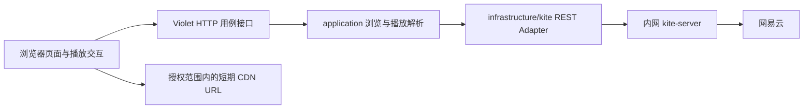

# Kite 接入可行性与范围建议

调查日期：2026-10-20。范围：Kite 公开仓库当前正式版本的服务端契约、实际装配与 Violet 接入选择；不实施业务接入，不安装依赖，不登录网易云、不下载音乐、不改外部资源。

## 结论摘要

1. **可以把 Kite 作为独立的网易云能力服务，但不是开箱即用的网页播放器。** 已有歌曲搜索、详情、播放 URL、歌词与歌单查询的 gRPC/REST 实现；浏览器播放状态、队列、权限与用户体验仍由 Violet 实现。建议首轮采用 **浏览器 → Violet BFF → 内网 Kite REST**，不让浏览器持有 Kite 令牌或网易云 Cookie。[契约与接入说明][integration] [实际服务注册][server]
2. **基线选 `v0.4.0`，不是滚动的 `latest`。** 调查时 GitHub 默认分支为 `main`，HEAD 与最新正式 release/tag 都指向 `c86238013c6e384f76cace96cb30dafa0fa9e5c9`。Release 发布于 `2026-10-19T23:41:22Z`，GitHub API 返回 `prerelease=false`，提供六种平台/架构的 server 压缩包及校验文件。本文源码引用固定该 commit；发布镜像与基本鉴权已在隔离容器实测，未验证生产部署或网易云播放。[正式 Release][release] [固定提交][commit]
3. **歌单完整分页是明确接入阻碍。** `AllTracks` 的契约有 `limit/offset`，但当前实现只传 `n=limit`，既不向上游发送 `offset`，也不在响应中切片。不能因接口名“全量/分页”就承诺用户能翻到整单。`GetPlaylist` 也只是请求 `n=1000`，没有补齐全部 track IDs 的逻辑。[分页实现][playlist-browse] [详情实现][playlist-detail] [服务转发][playlist-service]
4. **缓存、Cookie 池、自动续期不能按配置名推断已上线。** 发布入口使用 `cache.Noop{}` 与 `session.NoopStore{}`；未装配 Redis 或 Cookie 检查 worker，Provider timeout/retries 配置也没有传入 engine。服务有刷新登录 RPC，但 Cookie 的持久化、续期调度、失效处理由接入方负责。[服务入口][entry] [配置声明][config]
5. **最小合理产品是“站长指定公开歌单/曲目，匿名元数据与允许播放的免费歌曲”。** 无需先做个人账号、多源音乐平台、网易云歌单编辑或恢复旧 `playlist/player_version` 模型。如果产品要求完整歌单，必须先解决上游分页问题；不能把返回的首段当成全量。站长 VIP 登录态也不等于可向所有访客转授播放权益。[播放实现][song-url] [软件许可证][license]

## 调查方法与证据边界

- **事实**：读取 GitHub 仓库元数据、latest release、tags、固定提交源码，以及 Violet 当前的架构约定与既有装配样例。核心结论以 `proto`、endpoint、service、`cmd/server` 为准，文档只作为补充。
- **[INFERENCE] 推断**：从代码推导出的运行风险，明确标注；没有把源码里的历史测试说明当成本次实测结果。
- **提案**：本文所有 Violet 接入路径、DTO、缓存策略与验收计划均是下一轮可选方案，并非当前已实现能力。
- **未执行**：网易云成功业务请求、真实账号登录、音乐播放、生产部署与 Go SDK 编译。没有使用真实 Cookie；生产是否已部署 `v0.4.0`、密钥是否存在、网络是否连通均未知。
- 本轮旧 music 代码清理与本调查独立。接入设计以清理后的新需求为起点；保留历史数据表不意味着恢复旧领域模型或自动迁移旧数据。

### 隔离容器运行证据

实际拉取并启动 `ghcr.io/vod-studio/kite-server:v0.4.0`，拉取输出的 digest 为 `sha256:1bb5975f2fae1f560a6c3081dd00a9a3e826fd4e92f379fd75a7df84b749ad21`。业务探针通过同一个 Docker `--internal` 网络的临时 Node 客户端发起；Kite 无法访问外网，未接入 Violet。

| 场景 | 实际结果 |
|---|---|
| 镜像默认对外监听、不传 server token | 进程退出码 1，提示 `0.0.0.0:3722` 对外开放但未配置访问令牌。 |
| 设置临时 server token 后启动 | 日志报告 gRPC `3722`、HTTP `3721`，`auth=true`。 |
| 不带 token 访问 `GET /healthz` | HTTP 200，`{"status":"SERVING"}`。 |
| 不带或带错误 token 访问 `GET /api/v1/auth/status` | 均为 HTTP 401；`ErrorInfo.reason=SERVER_AUTH_FAILED`、`domain=kite.music`。 |
| 正确 token 访问同一账号状态接口 | 通过服务鉴权；由于隔离网络无法解析网易云域名，返回 HTTP 503、`UPSTREAM_UNAVAILABLE`，`metadata.provider=netease`。不据此声称账号查询成功。 |
| 不带 token 访问 `GET /api/v1/songs/invalid` | HTTP 400、gRPC code 3，路径 int64 转换先于业务鉴权执行，`details=[]`。因此不是每一种错误响应都有 `ErrorInfo`。 |

上述结果只证明镜像可运行、访问控制和部分错误契约；健康检查成功不证明上游可用，正确 token 也不等于网易云登录成功。

## 1. 可用版本与交付方式

| 项目 | 已核实事实 | 接入含义 |
|---|---|---|
| 源码/正式版本 | `main` HEAD = `v0.4.0` = `c86238013c6e384f76cace96cb30dafa0fa9e5c9` | 固定版本评估，升级时重查契约及实际实现。 |
| 服务端可执行文件 | Release 有 Linux/macOS/Windows × amd64/arm64 的 `kite-server_0.4.0_*`，另有 checksum 与 Sigstore bundle | 可独立运行，不需要把 Kite 编译进 Violet。[Release][release] |
| 容器发布 | 已拉取并启动 `ghcr.io/vod-studio/kite-server:v0.4.0`；发布配置同时声明 `v0.4`、`latest`，支持 linux/amd64、linux/arm64 | 本次 digest 见上方运行证据；生产仍须核验所选架构及网络并固定 digest。[发布配置][goreleaser] |
| Go module | `github.com/VOD-Studio/kite`；`go 1.26.0`、`toolchain go1.26.6` | 直接 import 仓库生成代码会进入此 module 的依赖管理范围。[go.mod][gomod] |
| Violet Go 基线 | 当前 [`api/go.mod`](../../api/go.mod) 为 `go 1.26.9` | 从声明看满足 Kite 的 Go 基线；实际依赖兼容性仍未编译验证。 |
| 许可证 | MIT，保留版权与许可声明；按现状提供、无担保 | 软件使用许可不授予网易云曲库、歌词、封面、录音或账号权益的再分发许可。[LICENSE][license] |

### Go gRPC 与 REST 的选择

**已核实的 Go import：**

- 仓库内生成包：`github.com/VOD-Studio/kite/gen/go/netease/music/v1`，声明包名为 `mmpb`，可用 `mmpb.NewSongServiceClient` 等生成客户端。`go_package` 可见 [song.proto][song-proto]；生成目录可见 [固定提交][commit]。
- 官方接入样例推荐 BSR 两包：
  - `buf.build/gen/go/vod-studio/kite/grpc/go/netease/music/v1/musicv1grpc`
  - `buf.build/gen/go/vod-studio/kite/protocolbuffers/go/netease/music/v1`
- 该提交的互操作工程实际固定：gRPC module `v1.6.2-20261017213358-4ec261178254.1`；protobuf module `v1.36.12-20261017213358-4ec261178254.2`；工程 `go 1.26.0`、gRPC runtime `v1.81.0`。这是可追溯的依赖样例，不等同于证明 BSR 最新版与 `v0.4.0` 的每个 proto 完全一致；下一轮采用时需比对所需方法，不能照抄文档的 `@latest`。[互操作 go.mod][interop] [官方 Go 示例][integration]

**提案：首轮选 REST。** 当前只需要少量读操作，Violet 后端可用已有 HTTP 技术栈，在一个 Adapter 内消化 proto JSON、双层认证和错误分类；避免直接依赖 Kite 全 module 或引入 BSR 获取/版本同步链。REST 降低的是依赖与部署耦合，不消除数据契约耦合，也不修复服务端分页缺陷。若后续调用面扩大、强类型生成与标准 `ErrorInfo` 更有价值，可在同一 Adapter 内切 gRPC；不要同时维护两套调用实现。gRPC 的优势是生成类型与标准 deadline；代价是 SDK/运行库和 HTTP/2 运维要求。

## 2. 真实接口表

所有 RPC 的完整名称均为 `/netease.music.v1.<Service>/<Method>`。表中 `{song_id}`、`{playlist_id}` 代表路径上的十进制 ID；生成 OpenAPI 用 `{songId}`、`{playlistId}` 命名同一占位符。正常响应为表内消息本身，不是 Violet 的业务包裹格式。[歌曲契约][song-proto] [搜索契约][search-proto] [歌单契约][playlist-proto] [OpenAPI][openapi]

| 能力 | gRPC 方法 | 精确 REST 请求与输入 | 输出与实际限制 |
|---|---|---|---|
| 搜索歌曲 | `SearchService/Search` | `GET /api/v1/search?keyword=...&type=SEARCH_TYPE_SONG&limit=20&offset=0`；proto 输入 `keyword:string,type:SearchType,limit:int32,offset:int32` | `SearchResponse{songs:Song[],total:int32,...}`。省略 type 默认单曲；`limit<=0` 默认 10；offset 实际透传。无已声明的服务端页大小上限。[搜索实现][search-impl] |
| 单首详情 | `SongService/GetSongDetail` | `GET /api/v1/songs/{song_id}`；输入 `song_id:int64` | `GetSongDetailResponse{song:Song}`。`Song` 含 `id,name,artists,album,duration_ms,fee`，不是播放授权结果。 |
| 可播放 URL | `SongService/GetSongURL` | `GET /api/v1/songs/{song_id}/url?level=SONG_LEVEL_STANDARD`；输入 `song_id:int64,level:SongLevel` | `GetSongURLResponse{url:SongURL}`；内层 `SongURL{id,url,bitrate,size,format}`。注意真实地址是响应 `url.url`。可选登录；上游 data 为空时报 not found，有 data 但 URL 为空仍可正常返回。[URL 实现][song-url] |
| 普通歌词 | `SongService/GetLyric` | `GET /api/v1/songs/{song_id}/lyric`；输入 `song_id:int64` | `GetLyricResponse{lyric:{lrc,translated,romanized}}`。均为字符串，不是已解析的时间轴。 |
| 逐字歌词 | `SongService/GetWordLyric` | `GET /api/v1/songs/{song_id}/word-lyric`；输入 `song_id:int64` | 独立契约，不必为首轮普通歌词额外接入。普通歌词/无歌词不是错误播放状态的替代判断。[歌曲契约][song-proto] |
| 歌单详情 | `PlaylistService/GetPlaylist` | `GET /api/v1/playlists/{playlist_id}`；输入 `playlist_id:int64` | `GetPlaylistResponse{playlist:{id,name,cover_url,track_count,creator,songs,play_count}}`；请求上游固定 `n=1000,s=8`，不保证 `songs.length==track_count`。[详情实现][playlist-detail] |
| 歌单曲目页 | `PlaylistService/AllTracks` | `GET /api/v1/playlists/{playlist_id}/tracks?limit=100&offset=0`；输入 `playlist_id:int64,limit:int32,offset:int32` | `AllTracksResponse{songs:Song[],total:int32}`。`limit<=0` 默认 100；**offset 当前未生效**，total 来自 trackCount，不代表已经拿齐。[分页实现][playlist-browse] |

### JSON 与能力陷阱

- REST 是 grpc-gateway 默认 JSON 编码；OpenAPI 中 ID、`durationMs`、`bitrate`、`size` 等 `int64` 为**字符串**，字段为 lowerCamelCase，如 `coverUrl/trackCount/durationMs`；不能直接把 proto snake_case 当成 REST DTO，也不能默认所有数字都是 JS number。BFF 应保留外部 ID 的字符串身份，并将集合字段规范为 `[]`。[OpenAPI][openapi] [gateway 装配][server]
- 音质枚举为 `SONG_LEVEL_STANDARD/EXHIGH/LOSSLESS/HRES`，缺省回退 standard；不是旧播放器的任意质量字符串，也不是 URL 格式选择保证。[歌曲契约][song-proto] [音质转换][song-url]
- 搜索 enum 中虽然有 LYRIC、DJ、VIDEO，当前响应映射没有对应 case；已有实际映射的是 SONG、ALBUM、ARTIST、PLAYLIST、USER、MV、ALL。**首轮只承诺歌曲搜索，不按 enum 清单宣称所有搜索类型可用。**[搜索实现][search-impl]
- 歌单详情和 AllTracks 标为 `AuthAnonymous`，普通 Execute 路径不向上游携带用户 Cookie。**[INFERENCE] 当前不能通过“加一个 Cookie 头”就承诺读取访客私密歌单。**[详情][playlist-detail] [分页][playlist-browse] [凭据选择][engine]
- **[INFERENCE] offset 改变却没有参与真实上游调用，不能实现正常的不同页读取。** 不能在 Violet 用重复翻页、猜 ID、拉取更多后伪装全量的方式掩盖；应在 Kite 修复/发布后做真实分页合同验收，或明确选择只显示“已取得部分曲目”的产品范围。

## 3. 双层认证、账号生命周期与密钥边界

### 两层凭据不是同一种权限

| 凭据 | gRPC | REST | 生命周期与归属 |
|---|---|---|---|
| Kite server access token | metadata `authorization: Bearer <token>` | `Authorization: Bearer <token>` | 运维配置的单一共享令牌，决定是否允许调用 Kite；不是网易云登录态。错误原因 `SERVER_AUTH_FAILED`。 |
| 网易云 Cookie | metadata `x-netease-cookie` | `Grpc-Metadata-X-Netease-Cookie` | 接入方按账号保存的上游会话；决定以哪个账号执行。登录失效原因 `LOGIN_REQUIRED`，与服务令牌错误分开。 |

两地址均为 loopback 且没配置 token 才允许免鉴权；任一监听地址不是 loopback 而 token 为空则拒绝启动。配置 token 后 loopback 同样鉴权。Token 与 token file 互斥，文件不存在或去空白后为空会拒绝启动。[安全约定][security] [配置实现][config]

### 登录与续期的实际契约

| 操作 | RPC / REST | 输入与输出 |
|---|---|---|
| 生成二维码 | `AuthService/LoginQrcode` / `GET /api/v1/auth/login/qrcode` | 无业务输入；返回 `qrcode{key,qrImage,url}`。**当前实现只填 key/url，不生成 qrImage**，页面需按 URL 绘制二维码。 |
| 轮询 | `AuthService/CheckQrcode` / `GET /api/v1/auth/login/qrcode/check?key=...` | 返回 `code,message,session`；状态为 EXPIRED=800、WAITING=801、SCANNED=802、CONFIRMED=803；REST 枚举按生成 JSON 契约处理。 |
| 查询状态 | `AuthService/LoginStatus` / `GET /api/v1/auth/status` | Cookie 在 metadata/header；返回 `session`，未登录可为空。实现对登录响应解码失败也返回空 session，不宜以此定位所有上游故障。 |
| 续期 | `AuthService/RefreshLogin` / `POST /api/v1/auth/refresh`，JSON `{}` | Cookie 在 metadata/header；返回 `{cookie}`，是输入 Cookie 合并上游新 Set-Cookie 后的**完整值**，应原子替换旧值，不是增量。 |
| 登出 | `AuthService/Logout` / `POST /api/v1/auth/logout`，JSON `{}` | Cookie 在 metadata/header；成功响应为空消息。无 Cookie 也可能成功，之后必须删除自己保存的会话。 |

证据：[auth.proto][auth-proto]、[AuthServer][auth-service]、[刷新实现][auth-endpoint]。官方建议约 2 秒轮询；这不是有保证的上游限额，也没有对 Cookie 有效期作机器可读承诺。[接入说明][integration]

**二维码登录额外门槛：**当前 `CheckQrcode` 只有在 code=803、Set-Cookie 非空、`DecodeLoginResponse` 成功且 userId 非 0 时才填 `session`；该提交没有在此处补调用 LoginStatus。因此 **CONFIRMED 并不由实现保证一定有可保存的 session**。下一轮若做个人账号，必须实际验收这条链，缺失 session 时不能向用户报告“绑定成功”。[AuthServer][auth-service]

**运行事实：**AuthServer 存在 `saveSession` 扩展点，但正式入口注入的是 NoopStore，不持久保存；没有在服务入口启动刷新任务。配置中 `CookieCheckInterval=6` 不是“每六小时自动续期已生效”。Cookie 本身也没有通过 Session 返回 expiresAt。[服务入口][entry] [auth.proto][auth-proto]

**提案：**

- Kite token 仅放 Violet 后端的 secret 注入或受控服务端配置，不进入公开 settings API、前端环境变量、SSR HTML、浏览器 localStorage、日志/追踪字段。选择文件注入时确保容器非 root 用户可读。
- 原始网易云 Cookie 仅由后端加密保存；密钥与业务数据库分离。浏览器只收到 QR URL、绑定状态与必要账号展示信息；禁止把 Kite 的整个登录/状态响应直接透传。
- 个人绑定必须绑定当前 Violet 用户及短期登录 challenge，限制 key 轮询归属；不能接受任意访客提交别人 key 后领取 session。解绑、重新登录、账号删除时清理服务端会话与对应私有缓存。
- 对同一账号刷新做并发互斥/版本控制，避免较旧刷新结果覆盖新 Cookie；续期间隔需基于实际有效期/失效观察确定，不能从 worker 配置倒推。`LOGIN_REQUIRED` 停止原样重试并请求重新授权；`SERVER_AUTH_FAILED` 由运维修复，不提示用户重新扫码。
- 单共享 token 没有调用方身份隔离与限流。Violet 必须只暴露实际获准的用例，不提供可任意选择 Kite path/method 的通用代理。[安全边界][security]

## 4. 错误、限额、超时、缓存与播放约束

### 错误分类

REST 失败体为 `{code,message,details}`，`code` 是 gRPC 数值，不是 HTTP 状态；从 `details` 中找到 `google.rpc.ErrorInfo`，同时检查 `domain="kite.music"` 与 `reason`。音乐源错误通常带 `metadata.provider="netease"`。不要解析 message 文本；网络/网关故障还可能不是此 JSON。[错误契约][errors]

| reason | gRPC / HTTP | Violet 建议语义（提案） |
|---|---|---|
| `SERVER_AUTH_FAILED` | UNAUTHENTICATED / 401 | 服务配置故障；不当作访客 Violet 登录失效。 |
| `LOGIN_REQUIRED` | UNAUTHENTICATED / 401 | 当前上游账号需重新绑定/登录；不要原样重试。 |
| `RESOURCE_NOT_FOUND` | NOT_FOUND / 404 | 资源不存在或没有可用结果；与“URL 字段空但成功”均需覆盖。 |
| `RATE_LIMITED` | RESOURCE_EXHAUSTED / 429 | 展示稍后再试；控制访问速率，不盲目连发。 |
| `UPSTREAM_UNAVAILABLE`、`CIRCUIT_OPEN` | UNAVAILABLE / 503 | 上游暂不可用；保留已有页面内容，不清空为无歌单。 |
| `UPSTREAM_INVALID_RESPONSE`、`INTERNAL` | INTERNAL / 500 | 契约或服务故障；不能当作空结果。 |
| `UNSUPPORTED` | UNIMPLEMENTED / 501 | 当前能力不支持。 |
| `CANCELED`、`DEADLINE_EXCEEDED` | CANCELED / 499、DEADLINE_EXCEEDED / 504 | 取消/超时；不无条件播放下一首造成请求风暴。 |

### 运行策略：声明与接线必须分开

- **事实：无 Kite 入站限流。** 没有可引用的网易云固定 QPS/日配额承诺，搜索与歌单请求也没有统一最大页大小钳制。提案是在 Violet 按公开/登录用户场景限制请求频率、分页大小和并发，不宣称“安全 QPS 为某个固定值”。[安全边界][security] [搜索实现][search-impl] [分页实现][playlist-browse]
- **事实：引擎默认单次上游 HTTP 超时 10 秒，最多重试 3 次（不含首次），间隔 200/400/800ms。** 仅上游不可用/限流类可重试；熔断初始化参数为 5 与 30 秒。REST server ReadTimeout/WriteTimeout 均为 10 秒、IdleTimeout 为 60 秒。[引擎][engine] [重试][retry] [server][server]
- **事实：`KITE_PROVIDER_UPSTREAM_TIMEOUT`、`KITE_PROVIDER_MAX_RETRIES` 虽然能被 config.Load 解析，正式 server 入口没有用它们配置 engine。** 不应把改这些环境变量列为当前有效的调参方案。[配置][config] [入口][entry]
- **[INFERENCE] 多次上游尝试的累计耗时可超过 REST 10 秒写超时。** HTTP 写超时也不等价于一个规范的业务 deadline 错误；BFF 应显式传递取消并设置端到端时间预算，不能叠加多层自动重试后仍承诺快速响应。具体预算留到实际链路测量确定。
- **事实：endpoint 有搜索 10 分钟、歌单 24 小时、播放 URL 30 分钟缓存策略，但发布入口使用 Noop cache，策略没有形成实际缓存。** 库内部 Execute 对有身份的可缓存响应按凭据指纹隔离，override 路径不缓存；这不等于已部署 Redis 缓存。[入口][entry] [缓存执行][execute] [搜索][search-impl] [歌单][playlist-browse] [URL][song-url]
- **提案：**元数据可在 Violet 按已选产品需求短期缓存；账号相关结果与匿名结果分区。首轮播放 URL 不落库、不做跨账号共享缓存，点击播放时解析。缓存命中不能绕过 Violet 的可见性/权限判断。

### URL、版权与浏览器播放

- 官方文档称直链“几十分钟后过期”，但 `SongURL` 只返回 `id/url/bitrate/size/format`，**没有 expiresAt/TTL**；endpoint 的 30 分钟缓存常量也不是上游有效期保证。[文档][integration] [契约][song-proto] [实现][song-url]
- 匿名只取得上游允许的免费歌曲链接，VIP/版权受限的链接可能为空；传 Cookie 后按该账号权益处理。`fee` 可用于展示提示，不能代替最终 URL/播放结果，也不能承诺会员一定可播放所有歌曲。[契约][song-proto] [实现][song-url]
- Kite 返回链接，不提供这里可直接使用的浏览器音频流服务。当前 URL 解析走 eapi；源码注释记录过 CDN 回源 403 与 UA 差异，说明“拿到 URL”并不证明浏览器成功播放。[实现][song-url]
- **待实测**：浏览器跨源加载、CDN 403/过期行为、Range/seek、移动 Safari 格式支持、音频编码、不同地域/账号权益。浏览器 `<audio>` 播放与 JS fetch/Web Audio 的 CORS 需求不同，不能仅做一次 JSON 请求就判定端到端可用。
- **提案：**优先返回临时直链交由浏览器原生音频加载，或由 BFF 做即时 302；二者都会让客户端看到直链，均不能隐藏其播放内容权限。不要默认增加音频反向代理、下载/离线缓存、转码或绕过 CDN 鉴权；这些会引入额外带宽、内容授权与运维责任，只有明确产品需求并确认合法性后再评估。

## 5. 部署与健康检查

**已实现：**

- 裸进程默认 gRPC `127.0.0.1:3722`、REST `127.0.0.1:3721`。发布容器为 `gcr.io/distroless/static-debian12:nonroot`，默认监听 `0.0.0.0`，因此必须提供 `KITE_SERVER_AUTH_TOKEN` 或 `KITE_SERVER_AUTH_TOKEN_FILE`。[配置][config] [Dockerfile.release][docker]
- 不内置 TLS。跨主机/不可信网络需要 TLS 终止或服务网格；token 是共享服务凭据，不是网络隔离的替代品。[安全说明][security]
- `GET /healthz` 无需 token：SERVING 返回 200 `{"status":"SERVING"}`，否则 503；gRPC 标准 `grpc.health.v1.Health/Check`、`Watch` 也免 token。reflection 仍需鉴权。[健康实现][server] [安全说明][security]
- **健康状态只反映本进程服务状态，不检查网易云、Cookie 可用性或 Redis。** 没有独立的上游 readiness 检查。SIGINT/SIGTERM 先设置 NOT_SERVING 再排空，入口关闭预算 5 秒。[server][server] [入口][entry]
- Kite 部署文档指定与 Violet 同机，加入 `violet_network`，别名 `kite`，不映射宿主端口；Violet 可访问 `http://kite:3721` 或 `kite:3722`。这是上游部署设计，**不是本调查确认了当前生产现状**。文档中的 `kite_url` 不能作为清理后 Violet 已有配置项使用。[部署文档][deploy]

**提案的最小配置：**独立 Kite 镜像版本/digest、内网地址、一个 server token secret；Violet 后端需要受控 Kite base URL、同一 token、端到端超时策略。仅个人账号场景才追加加密会话存储。当前发布 server 无需以 Redis 为启动前提；设置 `KITE_REDIS_*` 不会自动启用缓存。健康检查与上游业务探测分开，不能每次 liveness 都向网易云发请求。

## 6. Violet 的最小架构，不复活旧 music 模型

**当前仓库事实：**[`AGENTS.md`](../../AGENTS.md) 规定 DDD 单架构 `domain/application/infrastructure/interfaces/app`，由 `app/` 手工容器装配；前端 FSD 方向为 `shared → entities → features → widgets`。现有 [`releases_container.go`](../../api/internal/app/releases_container.go) 展示应用用例与外部 GitHub Adapter 的装配方式，可复用这种依赖方向，不复制其具体业务模型。

**提案的调用链：**

- **领域**只定义实际需要的外部曲目标识、展示信息、播放可用/不可用结果，不把 Kite protobuf 对象、Cookie 或 HTTP status 变成领域实体。不要为了未来多音乐源先建通用 provider 平台。
- **应用层**决定哪些歌单允许公开展示、访客是否可搜索、使用匿名还是当前账号凭据。对外只提供实际用例，不逐个复制 Kite 全部 RPC。
- **基础设施 Adapter**集中处理双层认证、decimal-string ID、枚举、`ErrorInfo`、响应空值和取消传播，让这些知识不散到 handler 与前端。
- **HTTP 层**沿用 Violet 现有响应、鉴权和权限约定；上游 401 不直接破坏 Violet 登录会话。容器接线留在 `app/`；Kite 不变成 Violet 后端的内部库。
- **前端**将浏览/播放场景放在对应 feature；只有出现真实跨 feature 消费时才上提曲目实体到 entities。API DTO 放 model，查询由现有请求/Query 机制管理；仅当产品要求跨路由持续播放时才设计全局播放器及队列持有位置。不要提前添加永久全局播放器、多个 player version 或后台管理整套页面。
- **数据**：不把播放 URL、远端完整曲库快照或 Cookie 塞进历史 `playlists/music_settings` 表；本轮保留历史表只是避免破坏用户数据。是否复用/迁移数据必须在明确新模型后单独决定。

### 两种产品的成本区别

| 维度 | 站长共享公开歌单 | 访客个人网易云账号 |
|---|---|---|
| 数据来源 | 站长提供外部歌单 ID，网易云继续作为内容真相源 | 绑定到当前 Violet 用户的上游账号，可能涉及私密内容 |
| 登录态 | 可以完全匿名；需要站长凭据时仍只保存在后端 | 每用户加密 Cookie、绑定状态、重新授权、退出/删除生命周期 |
| 展示与播放 | 元数据公开不等于所有歌曲可播；明确显示受限/部分曲目 | 依该用户权益请求；禁止共享 URL/缓存到其他用户 |
| schema | 固定单歌单/配置列表未必需新表；运行时编辑、排序、文案才考虑最小持久化 | 若支持跨设备持久绑定，通常需要用户与网易云身份/加密凭据关联；临时会话模式可选择短期存储但要说明失效语义 |
| 管理后台 | 不必先做；站长仍可在网易云维护内容 | 先有自己的绑定/解绑 UI；网易云建单、改名、加歌不是绑定账号的必需条件 |
| 额外风险 | 不得将站长 VIP Cookie 当作全民播放授权 | QR challenge 归属、凭据加密与轮换、租户隔离、完整授权与删除；私密歌单读能力目前不能承诺 |

**建议先选第一列的匿名模式。** 这不是降低用户已经确认的需求，而是下一轮立项范围建议；如果用户明确要求完整歌单/个人账号，就按对应门槛完成，不以截断列表或共享账号替代。

## 7. 下一轮阶段与合同验收

以下为下一轮业务接入的提案与验收计划；本次仅完成前述发布镜像、访问控制与隔离网络错误烟测。

### 阶段一：明确展示范围并验收上游

确认是指定公开歌单、任意搜索，还是个人账号；固定 Kite 版本与镜像 digest。用授权的少量公开样例，验收详情、搜索、歌词和免费歌曲 URL。**若必须展示全量歌单，先推动 Kite 修复 AllTracks，并发布可固定的新版本；不能在 v0.4.0 上直接把“分页可用”列为通过。**

### 阶段二：匿名只读与按需播放的完整用例

只接产品选择的接口：指定歌单场景不必开放任意搜索；需要搜索才增加搜索。Violet Adapter/BFF、页面列表、按点击解析 URL、原生播放、不可用/过期/上游故障反馈作为一个端到端交付。是否跨路由持续播放由产品选择，不能由旧代码默认决定。不做账号绑定、网易云写操作、下载、代理音频或管理员全量平台。

### 阶段三：仅在需要时增加账号或管理能力

个人账号以可实际完成的扫码绑定、隔离 Cookie、状态、续期、解绑为一整条链，先验证 CONFIRMED 是否返回有效 session。站长运行时管理歌单引用则只增加所需的最小配置/排序/权限；“编辑本站展示列表”与“修改网易云歌单内容”是两个需求，分开立项。

### 合同验收清单

| 合同 | 必须观察的结果 |
|---|---|
| 凭据隔离 | 浏览器请求/响应、SSR、前端 bundle、日志不出现 Kite token 或网易云 Cookie；用户 A 的私有结果不被 B/匿名命中。 |
| 服务鉴权 | 正确 token 可调用；缺失/错误 token 得到 `SERVER_AUTH_FAILED`；非 loopback 无 token 启动失败；健康检查仍可用。 |
| REST 解析 | ID 与 int64 字符串、camelCase、枚举、空数组、空歌词、`url.url=""`、非 JSON 网关错误均被明确处理。 |
| 搜索 | 所选类型真实返回；不同 offset 的可验证结果；关键词编码正确；页大小与并发受控。 |
| 歌单完整性 | 超过一页的已知公开歌单，第二页不是第一页重复；总数、曲目唯一 ID、缺失/下架曲目处理有定义；不把 trackCount 当成已加载数量。 |
| 播放 | 免费歌曲在目标浏览器实际播放、暂停、seek；VIP/受限/不存在/过期/CDN 拒绝可解释，不伪装成功；不下载整首作为默认探测。 |
| 错误 | `SERVER_AUTH_FAILED` 与 `LOGIN_REQUIRED` 不混淆；429/503/超时不导致无限重试；失败不覆盖有效已有数据为空数组。 |
| 生命周期 | 断网/取消/切页停止不再需要的请求；端到端超时不因多层重试失控；Kite 重启不要求整个 Violet 不可用。 |
| 账号（若选） | QR 过期、扫描、确认但缺 session、成功绑定、有效/失效 Cookie、续期替换、并发刷新、解绑删除均覆盖；不能只测“二维码显示了”。 |
| 发布 | 固定版本/digest可拉取，私网 DNS 与端口连通，secret 可读，healthz 与真实业务就绪分开，失败可回滚。 |

## 8. 必须由产品决定与仍未解决的问题

1. **入口是什么？** 独立音乐页、文章嵌入、侧栏卡片，还是跨站持久播放器？本次不默认恢复旧全局组件。
2. **内容由谁维护？** 一个或少数网易云公开歌单 ID，还是本站管理员创建独立合集？前者通常不需要歌单 CRUD/schema；后者才讨论持久化与权限。
3. **全量是否硬要求？** 如是，Kite v0.4.0 的 AllTracks 缺陷是阻碍；如允许片段展示，UI 必须明确“部分曲目”，不能冒充完整导入。
4. **是否允许任意访客搜索/解析任意曲目？** 这会扩大滥用与上游额度成本；指定展示列表不是开放音乐代理。
5. **播放权益与范围？** 匿名可播、个人账号权益还是站长账号？站长授权不自动解决公共播放/内容再分发许可；不能承诺无版权/VIP绕过。
6. **是否需要个人账号？** 如需要，用户会话、加密、解绑、隐私删除、QR 完成后 session 的真实返回形状与私密歌单读取必须单独验证，不能只加一个 Cookie 配置结束。
7. **未实测的技术前提：** 生产 Kite 版本/digest与网络、CDN链接浏览器可用性/地区限制/确切有效期、网易云实际分页与配额、BSR生成包与选定版本契约一致性。
8. **不可当成现成能力的内容：** 自动 Redis 缓存、自动 Cookie 池续期、可配置上游 timeout/retries 的 server 接线、完整歌单分页、全部搜索 enum。路线图还包含未来 TUI、评论/MV/排行榜/电台等扩展；历史 roadmap 的“78 RPC”与播放设想不是当前服务能力保证，本文以已注册实现为准。[路线图][roadmap] [入口][entry] [服务注册][server]

**下一轮建议范围：先确认“指定公开歌单/曲目 + 匿名只读 + 按需播放”是否满足目标，再决定是否需要 schema 与管理页面；完整歌单必须先修复上游分页。当前提交只提供研究结论，不新增 Kite 依赖、接口或配置。**

## 一手来源索引

以下源码链接全部固定到 `c86238013c6e384f76cace96cb30dafa0fa9e5c9`，避免默认分支变化后无法复核。

[release]: https://github.com/VOD-Studio/kite/releases/tag/v0.4.0
[commit]: https://github.com/VOD-Studio/kite/tree/c86238013c6e384f76cace96cb30dafa0fa9e5c9
[integration]: https://github.com/VOD-Studio/kite/blob/c86238013c6e384f76cace96cb30dafa0fa9e5c9/docs/integration.md
[security]: https://github.com/VOD-Studio/kite/blob/c86238013c6e384f76cace96cb30dafa0fa9e5c9/docs/server-security.md
[deploy]: https://github.com/VOD-Studio/kite/blob/c86238013c6e384f76cace96cb30dafa0fa9e5c9/docs/deploy.md
[errors]: https://github.com/VOD-Studio/kite/blob/c86238013c6e384f76cace96cb30dafa0fa9e5c9/docs/grpc-errors.md
[song-proto]: https://github.com/VOD-Studio/kite/blob/c86238013c6e384f76cace96cb30dafa0fa9e5c9/proto/netease/music/v1/song.proto
[search-proto]: https://github.com/VOD-Studio/kite/blob/c86238013c6e384f76cace96cb30dafa0fa9e5c9/proto/netease/music/v1/search.proto
[playlist-proto]: https://github.com/VOD-Studio/kite/blob/c86238013c6e384f76cace96cb30dafa0fa9e5c9/proto/netease/music/v1/playlist.proto
[auth-proto]: https://github.com/VOD-Studio/kite/blob/c86238013c6e384f76cace96cb30dafa0fa9e5c9/proto/netease/music/v1/auth.proto
[openapi]: https://github.com/VOD-Studio/kite/blob/c86238013c6e384f76cace96cb30dafa0fa9e5c9/gen/openapi/kite.swagger.json
[entry]: https://github.com/VOD-Studio/kite/blob/c86238013c6e384f76cace96cb30dafa0fa9e5c9/cmd/server/main.go
[config]: https://github.com/VOD-Studio/kite/blob/c86238013c6e384f76cace96cb30dafa0fa9e5c9/config/config.go
[server]: https://github.com/VOD-Studio/kite/blob/c86238013c6e384f76cace96cb30dafa0fa9e5c9/internal/server/grpc.go
[engine]: https://github.com/VOD-Studio/kite/blob/c86238013c6e384f76cace96cb30dafa0fa9e5c9/internal/netease/engine/engine.go
[execute]: https://github.com/VOD-Studio/kite/blob/c86238013c6e384f76cace96cb30dafa0fa9e5c9/internal/netease/engine/execute.go
[retry]: https://github.com/VOD-Studio/kite/blob/c86238013c6e384f76cace96cb30dafa0fa9e5c9/internal/netease/engine/retry.go
[song-url]: https://github.com/VOD-Studio/kite/blob/c86238013c6e384f76cace96cb30dafa0fa9e5c9/internal/netease/endpoint/song/url.go
[search-impl]: https://github.com/VOD-Studio/kite/blob/c86238013c6e384f76cace96cb30dafa0fa9e5c9/internal/netease/endpoint/search/search.go
[playlist-detail]: https://github.com/VOD-Studio/kite/blob/c86238013c6e384f76cace96cb30dafa0fa9e5c9/internal/netease/endpoint/playlist/detail.go
[playlist-browse]: https://github.com/VOD-Studio/kite/blob/c86238013c6e384f76cace96cb30dafa0fa9e5c9/internal/netease/endpoint/playlist/browse.go
[playlist-service]: https://github.com/VOD-Studio/kite/blob/c86238013c6e384f76cace96cb30dafa0fa9e5c9/internal/service/playlist.go
[auth-service]: https://github.com/VOD-Studio/kite/blob/c86238013c6e384f76cace96cb30dafa0fa9e5c9/internal/service/auth.go
[auth-endpoint]: https://github.com/VOD-Studio/kite/blob/c86238013c6e384f76cace96cb30dafa0fa9e5c9/internal/netease/endpoint/auth/auth.go
[gomod]: https://github.com/VOD-Studio/kite/blob/c86238013c6e384f76cace96cb30dafa0fa9e5c9/go.mod
[interop]: https://github.com/VOD-Studio/kite/blob/c86238013c6e384f76cace96cb30dafa0fa9e5c9/interop/go/go.mod
[docker]: https://github.com/VOD-Studio/kite/blob/c86238013c6e384f76cace96cb30dafa0fa9e5c9/Dockerfile.release
[goreleaser]: https://github.com/VOD-Studio/kite/blob/c86238013c6e384f76cace96cb30dafa0fa9e5c9/.goreleaser.yaml
[roadmap]: https://github.com/VOD-Studio/kite/blob/c86238013c6e384f76cace96cb30dafa0fa9e5c9/docs/kite-roadmap.md
[license]: https://github.com/VOD-Studio/kite/blob/c86238013c6e384f76cace96cb30dafa0fa9e5c9/LICENSE
