# 图块与流程图

图块承载结构化图示（流程图、时序图、状态图等），架构与数学公式同源（ADR-0004 图块模型）：通用 `format` 属性节点 + 围栏块 Markdown 载体 + 浏览时渲染 + 渲染器注册表。当前支持 **Mermaid** 格式，后续按渲染器注册表纯增量扩展其他格式。

> 本章每张图都是**可直接渲染的真实 mermaid 源码**——站内本章页画出来的就是最终效果（手绘风格 SVG），而非源码文本。mermaid 覆盖流程图、时序图、类图、状态图、ER、甘特、饼图、思维导图等十余种图类型，下面逐类给出示例。

## 输入与形态

用 ` ```mermaid ` 围栏块或 Slash 菜单「流程图」插入。每张图是一个独立图块节点（atom），点击进入弹层编辑（源码 + 实时预览），`Esc` / 点击外部退出。主题跟随站点明暗——框架色（背景、文字、线条）对齐站点配色，节点填色保留 mermaid 默认彩色以便区分。

> **输入提示**：最稳的方式是走 Slash 菜单「流程图」或直接粘贴 ` ```mermaid ` 围栏块。手动逐字键入围栏可能先被识别为普通代码块，撤销后改走 Slash 菜单即可。

## 流程图（Flowchart）

最常用。`graph` 或 `flowchart` 起头，方向 `TB`/`TD`（上下）、`LR`（左右）、`BT`/`RL`。节点形状用括号区分：`[矩形]`、`(圆角)`、`{菱形}`、`((圆形))`、`>旗形]`、`[/平行四边形/]`。

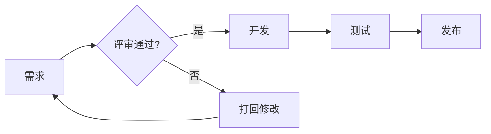

子图（subgraph）分组、虚线箭头(`-.->`)、带文字箭头(`-->|文字|`)、样式按节点 id 指定（`class A red;` 配 `classDef red fill:#fee`）。

## 时序图（Sequence）

参与者之间的消息时序。`participant` 声明角色，`->>` 实线实心箭头、`-->>` 虚线、`--)`/`--)` 异步、`x` 失败。`activate`/`deactivate` 显示激活条，`Note over/aside` 加注释，`loop`/`alt`/`opt`/`par` 分组。

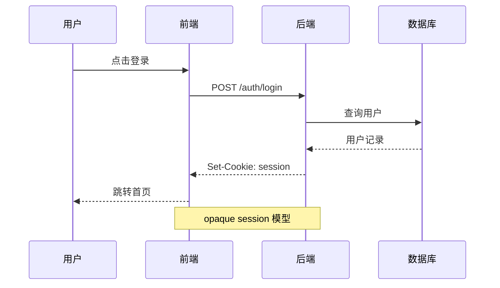

## 类图（Class Diagram）

UML 类关系。`class` 定义类（属性 `+`public/`-`private/`#`protected），关系：`<|--` 继承、`*--` 组合、`o--` 聚合、`-->` 关联、`..>` 依赖、`..|>` 实现。

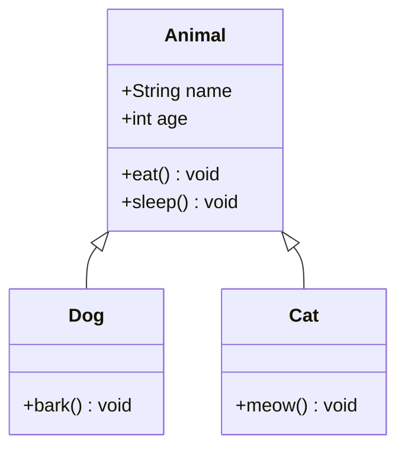

## 状态图（State Diagram）

状态机。`stateDiagram-v2` 起头（v2 语法更全），`[*]` 表示起止状态，`A --> B: 触发条件`。`note` 加注释，复合状态用 `state 名称 {...}` 嵌套。

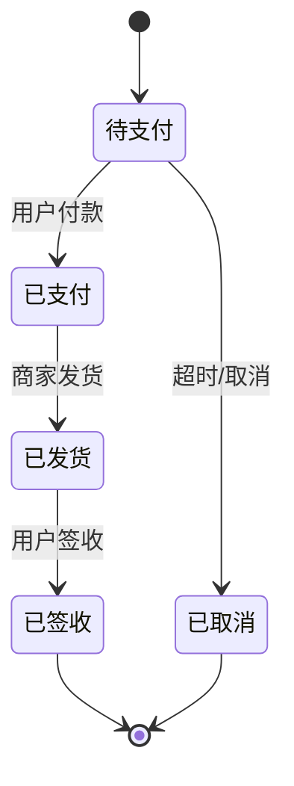

## 实体关系图（ER Diagram）

数据库表关系。`实体A ||--o{ 实体B : "关系名"`，连接符四段：基数（`||` 一对一、`}|` 一对多强制、`o{` 零对多）+ 关系线。字段在实体 `{}` 内，`PK`/`FK` 标主外键。

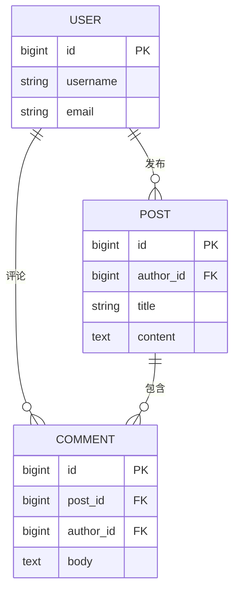

## 甘特图（Gantt）

项目排期。`dateFormat` 指定日期格式，`section` 分组，任务语法 `名称 :状态, id, 起始, 持续`。状态 `done`/`active`/`crit`/空（待办），`after id` 表示依赖前序任务。

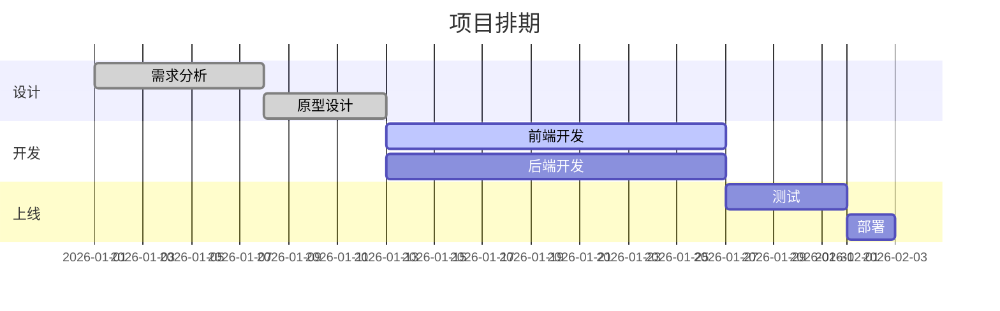

## 饼图（Pie Chart）

占比可视化。`pie title 标题` 起头，每行 `"标签" : 数值`。

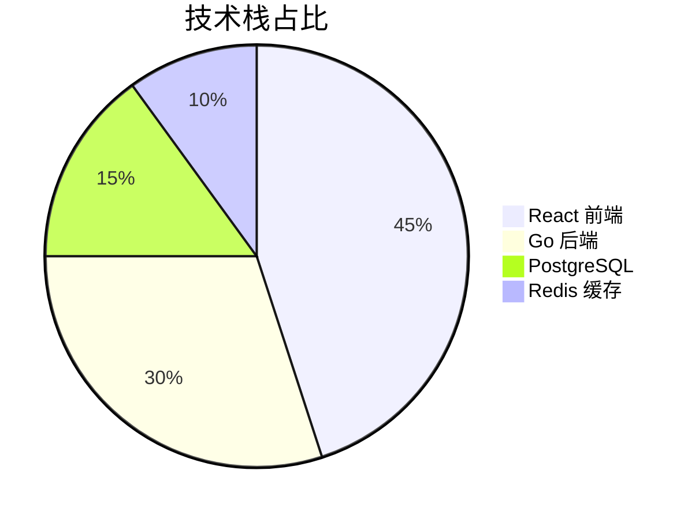

## 用户旅程图（User Journey）

体验地图，按步骤打分（0-5，越高越满意）。`journey title` 起头，`section` 分阶段，每行 `任务名: 分数: 参与者`。

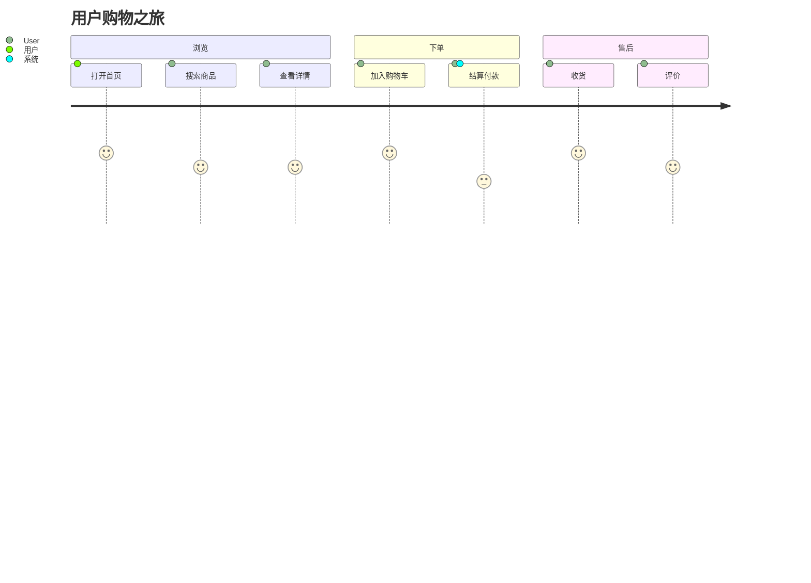

## 思维导图（Mindmap）

树状发散。`mindmap` 起头，缩进表达层级（不同深度的节点形状可用 `((圆形))`、`[方形]`、`(圆角)` 区分）。

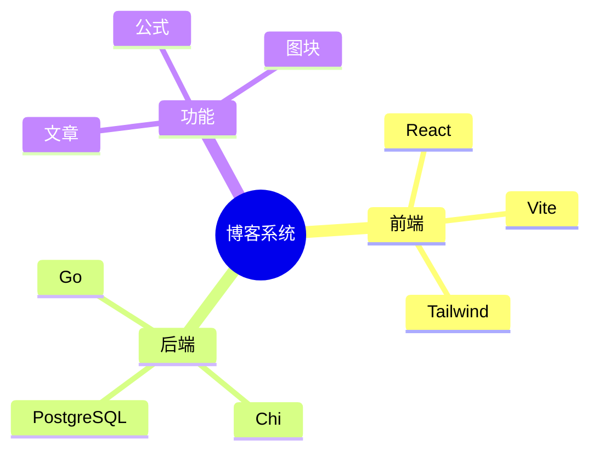

> 思维导图靠缩进定层级，**必须用空格缩进**（与编辑器整体 4 空格缩进一致），不要混 Tab。

## 时间线（Timeline）

按时间排列的事件。`timeline title` 起头，`时间段 : 事件`，同一时间段下多事件换行缩进。

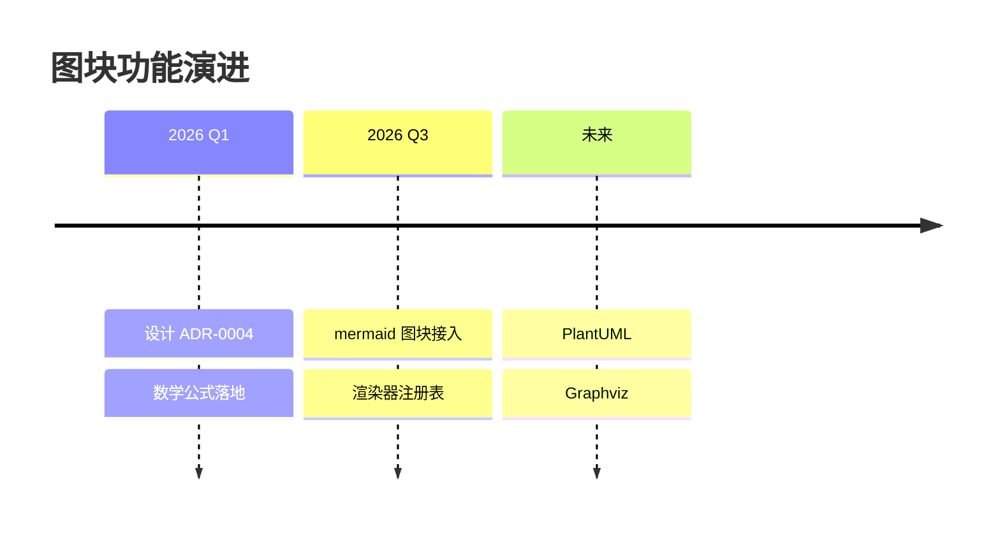

## Git 图（Gitgraph）

分支与提交历史。`gitGraph` 起头，`commit` 提交、`branch 名称` 建分支、`checkout 名称` 切换、`merge 名称` 合并。提交可加 `id:`/`tag:`/`type:`（NORMAL/REVERSE/HIGHLIGHT）。

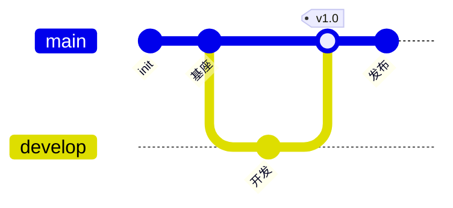

## 象限图（Quadrant Chart）

四象限定位。`quadrantChart title` 起头，定义 `x-axis`/`y-axis`、四个 `quadrant-N` 标签，数据点 `名称: [x, y]`（0-1 归一化坐标）。

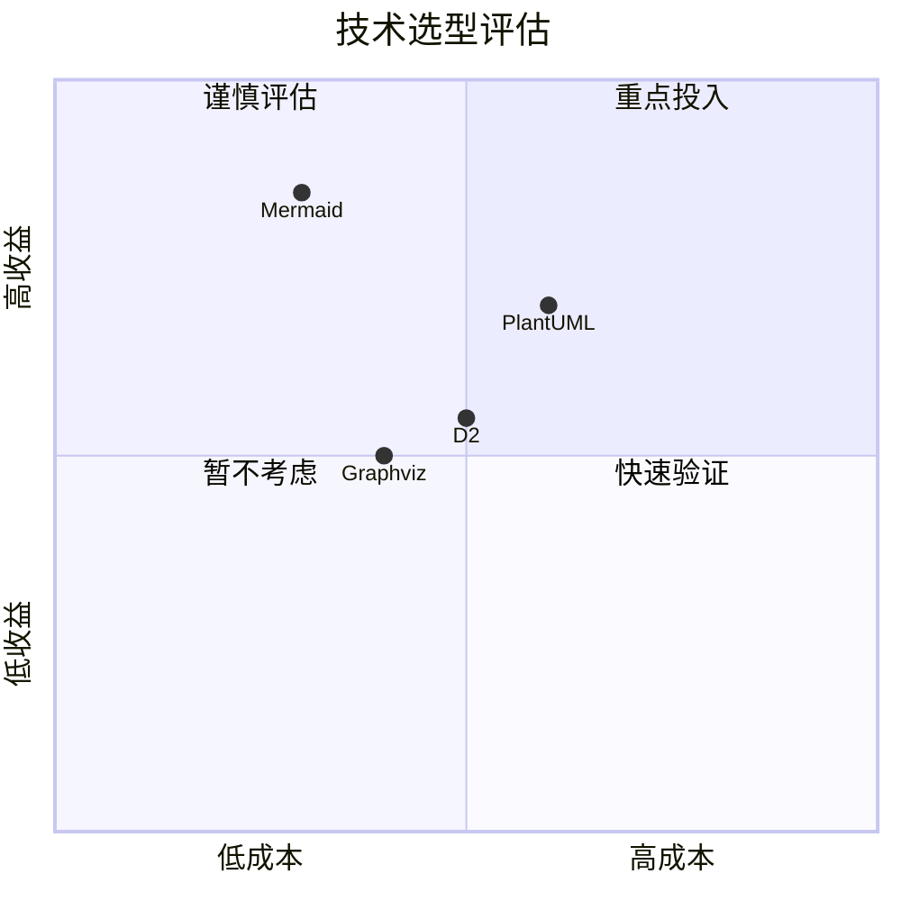

## 数值图表（XYChart）

柱状 / 折线图（beta，语法稳定中）。`xychart-beta` 起头，`title`、`x-axis` 标签数组、`y-axis "名称" 下限 --> 上限`，`bar [...]`/`line [...]` 数据。

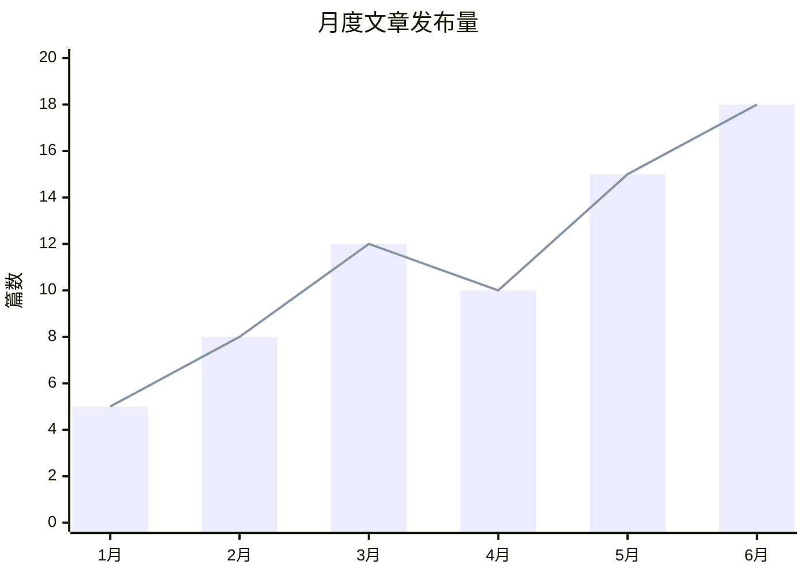

> 还有 C4 架构图、需求图（Requirement）、桑基图（Sankey）、看板（Kanban）、数据包（Packet）等更小众类型，语法见 [mermaid 官方文档](https://mermaid.js.org/intro/)，渲染管线一致。

## 渲染与安全

- **浏览时渲染**：content_html 只存语义化标记 `<div data-type="diagram-block" data-format="mermaid" data-source="...">`，最终 SVG 在读者浏览器渲染，不烘焙进 HTML（体积小、主题可跟随、源码可搜索可复制、升级渲染器不动存量数据）。
- **统一手绘**：Mermaid 负责语义与布局，净化后的 SVG 统一经 `@violetjs/inkline` 以 G 笔、草稿手法转换轮廓、填色与连线，不依赖 Mermaid 原生 `handDrawn` 的图型覆盖。虚线改用恒宽签字笔以保留虚线样式，名义线宽 4 以上的粗线减弱压感，避免收成梭形。编辑器预览与阅读端同源；相同几何使用固定笔触种子，文字和箭头保留原始语义。已验证本章全部 13 种示例图型。
- **手写字体 CDN**：英文使用 Excalifont（Excalidraw 0.18.1 发布分片），中文使用小赖体（Xiaolai SC）。图块按需声明 `@font-face`，等待标签所需分片加载后再测量布局；中文分片来自[中文网字计划](https://chinese-font.netlify.app/zh-cn/cdn/)。首次加载需要可访问字体 CDN，字体未覆盖的字符使用系统回退字体。
- **导出字体与许可**：SVG 文件内嵌实际标签所需的 WOFF2 分片、版权与完整 OFL 通知，不依赖站点样式或远端字体；PNG 由同一 SVG 栅格化。仓库保留两份手绘字体许可作为导出通知来源，不保存字体二进制副本。
- **宽图**：保持自然字号，在图内横向滚动，不将整张图缩成小字。
- **甘特图**：以 920px 自然宽度布局，任务字号 14px、日期字号 12px；只隐藏碰撞的日期文字，保留原始刻度、任务日期、时间格式与作者设置的刻度间隔。任务与日期轴之间保留独立间距，顶部日期轴和小时级项目使用同一避碰规则。
- **双重 XSS 防线**：全局 `securityLevel: strict` + render 产物经 DOMPurify 二次清理。mermaid 支持 per-diagram `%%{init}%%` 指令覆盖全局 strict（docmost CVE-2026-23630 的存储型 XSS 攻击路径），第二道 DOMPurify 兜底剥除 `<script>`、`on*` 事件属性、`foreignObject` 可执行内容。
- **主题重渲染**：mermaid 把颜色烘焙进 SVG，切主题需重新渲染（非 CSS 跟随）。组件持有 source，主题变化时重新 initialize + 重渲染所有可见图块。

## 渲染器注册表（扩展机制）

图块通过 **`format → 渲染器`** 注册表支持多格式扩展，收敛了原本散落在阅读端的 if/else 分发。新增图表格式只需：

1. 在 `shared/ui/diagram/` 注册表登记一个渲染器组件（含 lazy 加载、主题适配、错误降级）
2. 扩展 `diagramBlock` 节点的 `format` 属性取值
3. Slash 菜单与围栏 info string 增加对应入口

分发逻辑集中在注册表，不散落在分发代码里，互不影响。

## 其它图表格式（路线图）

上面各节都是 mermaid 一种格式内的图类型。图块的 `format` 属性还支持接入**其它独立的图表语言**（每种自带渲染器）。下表穷举业界主流格式，按渲染路径分组——纯前端渲染的接入成本低（注册 lazy 组件即可），需服务端的要评估渲染服务部署。

### 纯前端渲染（浏览器内，无需后端）

| 格式 | info string | 渲染依赖 | 适用场景 | 状态 |
|---|---|---|---|---|
| Mermaid | ` ```mermaid ` | mermaid.js | 见上文各节，覆盖最广 | **已实现** |
| Graphviz (DOT) | ` ```dot ` 或 ` ```graphviz ` | viz.js (Wasm) | 通用有向 / 无向图、依赖图、状态机，学术与图谱可视化 | 规划中 |
| D2 | ` ```d2 ` | @terrastruct/d2（Wasm 或 JS） | 现代架构图，多布局引擎，语法比 mermaid 更适合复杂拓扑 | 规划中 |
| nomnoml | ` ```nomnoml ` | nomnoml | UML 类图专用，极简语法，适合快速类关系 | 规划中 |
| Excalidraw | ` ```excalidraw ` | @excalidraw/excalidraw | 手绘风格草图 / 白板，SVG/JSON 源 | 评估中 |
| Markwhen | ` ```markwhen ` | markwhen | 时间线 / Gantt / 项目里程碑，Markdown 风语法 | 评估中 |

### 需服务端渲染（前端发源码，后端返回 SVG/PNG）

这些格式依赖 Java / 二进制运行时或大型布局引擎，浏览器内渲染成本过高，走后端渲染服务。部署可选自建渲染服务（如 PlantUML Server、Kroki）或对接 [Kroki.io](https://kroki.io) 公共实例。

| 格式 | info string | 运行时 | 适用场景 | 状态 |
|---|---|---|---|---|
| PlantUML | ` ```plantuml ` | Java | 全 UML 覆盖（类 / 组件 / 部署 / 时序 / 活动），企业生态成熟 | 规划中 |
| Structurizr DSL | ` ```structurizr ` | Java | C4 模型架构图（上下文 / 容器 / 组件），单一模型多视图 | 评估中 |
| Blockdiag | ` ```blockdiag ` | Python | 简单框图 / 网络图 / 时序图，日系生态 | 评估中 |
| ditaa | ` ```ditaa ` | Java | ASCII 草图转结构图，嵌入式文档常用 | 评估中 |
| Pikchr | ` ```pikchr ` | C 二进制 | PIC 风格精确布局，Fossil 文档系统原生 | 评估中 |
| DBML | ` ```dbml ` | JS（@dbml/core） | 数据库 schema（ER 图），DBDiagram 语法 | 评估中 |

> **Kroki 统一渲染网关**：上述服务端格式可通过部署 [Kroki](https://kroki.io) 一个服务统一承接（支持 PlantUML / Graphviz / D2 / Blockdiag / ditaa / Pikchr / DBML / Structurizr 等十余种格式），减少自建多种运行时的成本。未来接入服务端格式时，建议优先评估 Kroki 而非逐个自建。

> 新增格式的优先级与排期见 issue 跟踪。

## 容错与降级

- **语法错误**：编辑器内显示 mermaid 报错信息（便于作者定位）；阅读端降级为「图表渲染失败」占位 + 折叠的源码（不向读者暴露详细错误）。
- **无 JS 环境**：显示 mermaid 源码文本（源码本身可读，与公式降级一致）。
- **未知 format**：注册表查不到对应渲染器时，降级显示 source 文本。
